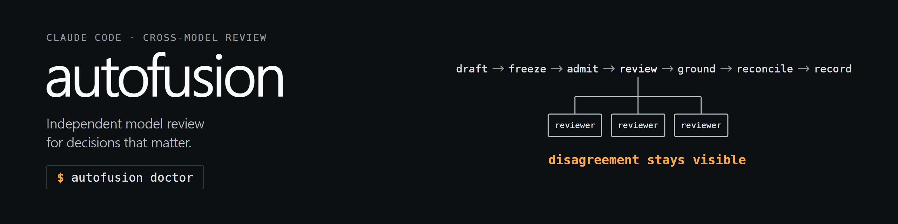

  

# autofusion

**Claude Code-first independent cross-model review, executed checks where applicable, and metadata-only receipts for consequential AI-assisted decisions (alpha runtime).**

autofusion helps people examine consequential AI-assisted decisions through independent model review, executed checks where applicable, and a traceable record of what changed. Its purpose is to make important work easier to challenge and verify before people rely on it.

It is for researchers, engineers, and heavy agent users who work intensely with AI. Run fusion on decisions that matter, where a missed issue would be costly or difficult to reverse. Routine work stays with one model.

The active Claude Code session drafts the work and reconciles the findings. Independent reviewers examine the same frozen artifact, trusted verification steps ground eligible claims, and the final record preserves unresolved disagreement. Evaluation should distinguish dated transport checks and executed verification from measured improvements in decision quality. autofusion provides the method; [claude-oauth](https://github.com/OnourImpram/claude-oauth) provides the plumbing for models available through the operator's existing sessions.

## Why fusion, and why not a bigger panel

A larger panel is not automatically a better panel. Models can share blind spots, judges can be biased by answer order, and a polished synthesis can hide unresolved contradictions. autofusion therefore optimizes for four things:

1. Independent review paths, with blind identities and answer-order reversal where a judge compares proposals.
2. Executable evidence where the artifact permits it: a finding that a trusted verification command confirms outranks a finding that two models merely agree on.
3. Visible contradictions instead of forced consensus. Agreement is recorded as agreement, never promoted to confidence on its own.
4. Honest run accounting. A run whose required reviewer failed, whose packet did not fit, or whose grounding could not execute records degraded state and cannot claim fused success.

If you work intensely with AI, the recommendation is simple: keep one model for routine work, and run fusion on the decisions that matter.

## The method

1. **Draft.** The active session, called `self`, produces the artifact: a diff, a plan, an answer, a release, a manuscript section.
2. **Freeze.** The runtime takes an immutable snapshot and compiles one hash-addressed packet. Credential-shaped text is redacted or blocks dispatch under the configured policy.
3. **Admit.** Every participant passes the same role, model, provider, callable, compound and context-fit checks before any provider is called. The packet must fit the smallest participant, including prompt overhead and reserved output.
4. **Review independently.** One or more external reviewers examine the same packet without seeing each other. Compound providers whose hidden workers cannot be observed count as one vote.
5. **Ground.** Checkable findings run through trusted verification IDs whose argument vectors were approved before review. Reviewer text is never executed.
6. **Reconcile.** `self` reconciles findings against evidence. Unresolved blocker or major findings may receive one challenge and one rebuttal; debate is bounded.
7. **Record.** A metadata-only receipt links the packet, the calls, the grounding, the analysis and the decision through hashes. A `ship` receipt is valid only when the linked analysis has no blocker or major findings.

`self` is a sentinel, not a transport. No Python path invokes the active Claude Code session, and the current session's model may never appear as a reviewer, judge or delegate. That rule is enforced at configuration load, at admission and at the HTTP boundary, and each enforcement has a test that fails when it is removed.

## What is measured, and how

| Claim | Status | Evidence |
| --- | --- | --- |
| `self` is non-callable; Fable and Mythos are admitted only as `self` | Implemented and unit-tested | `tests/test_identity_migration.py`, `tests/test_admission.py`; mutation notes in `CHANGELOG.md` |
| Uniform admission for every dispatched participant, including advisor and direct calls | Implemented and unit-tested | `tests/test_admission.py` |
| Routing minimums enforced against the actual panel, not its label | Implemented and unit-tested | `tests/test_config_policy.py`, `tests/test_routing_aliases.py` |
| Cost caps and redaction policy can be tightened by local configuration, never relaxed | Implemented and unit-tested | `tests/test_config_policy.py` |
| One execution deadline across dispatch, queued work and grounding | Implemented and unit-tested | `tests/test_request_deadlines.py`, `tests/test_engine.py` |
| Context fit against the smallest participant, with prompt overhead and output reserve | Implemented and unit-tested | `tests/test_context_fit.py`, `tests/test_engine_context.py` |
| Coverage gaps and reviewer abstention survive analysis, reconciliation and receipts | Implemented and unit-tested | `tests/test_analysis_coverage.py`, `tests/test_pending_binding.py` |
| Proof capsules bind to the reviewed revision and survive finalization retries | Implemented and unit-tested | `tests/test_proof_binding.py`, `tests/test_finalization_race.py` |
| Complete credential structures, including PEM blocks, never reach a provider | Implemented and unit-tested | `tests/test_dlp_structures.py` |
| Codex CLI route for `gpt-5.6-sol` at xhigh and ultra (previous generation) | Measured live, July 2026 | `docs/provider-verification.md` |
| Codex CLI route for `gpt-6.1-sol` at xhigh and ultra, `gpt-6.1-terra` and `gpt-6-luna` | Measured live, 15 November 2026: one bounded call per profile, schema-valid output | `docs/provider-verification.md`, `tests/test_model_generation.py` |
| Codex CLI route for `gpt-6-astra` at ultra | Measured live, 8 September 2026, configured-route identity only | `docs/provider-verification.md`, `docs/provider-astra-smoke-20260908.json` |
| Claude CLI route for the `opus` alias | Measured live, 15 November 2026, effective model `claude-opus-5-5`; the July 2026 measurement was Opus 4.8 | `docs/provider-verification.md` |
| Antigravity `agy` headless transport, `gemini-flash` profile | Implemented and unit-tested; earlier live smoke returned no terminal identity; on 15 November 2026, after the adapter accepted `init.model` matched by `conversation_id`, one bounded schema-valid call completed (`gemini-3.8-flash-high`) and the profile ships enabled | `tests/test_agy.py`, `tests/test_agy_session_identity.py`, `docs/provider-verification.md` |
| Antigravity `agy` headless transport, `gemini-argon`, `gemini-carbon` and `gemini-hydrogen` profiles | Live smoke, 15 November 2026: in the first run, `agy` 1.5.9 named the model in its session `init` event only and the terminal result carried no identity, so the adapter rejected each result; after the adapter accepted `init.model` matched by `conversation_id` (`provider-response` evidence), one bounded schema-valid call per profile completed (`gemini-4-argon-high`, `gemini-4-carbon-high`, `gemini-4-hydrogen-xhigh`) alongside a live mismatch negative control, and all three ship enabled | `tests/test_agy.py`, `tests/test_agy_session_identity.py`, `tests/test_model_generation.py`, `docs/provider-verification.md` |
| ACP transport, `grok` profile | Implemented and unit-tested; the earlier live smoke, run under the `grok-4.6` profile, did not complete initialization; the `grok-4.7` smoke of 15 November 2026 stopped at the ACP preflight before any model call, and the profile ships disabled | `tests/test_acp.py`, `tests/test_acp_integration.py` |
| Handles name a model family, never a version; one handle per family name, effort and compound flag | Implemented and unit-tested | `tests/test_model_generation.py` |
| OpenAI-compatible route with the output contract in the prompt, `chatgpt-web-high` and `chatgpt-web-xhigh` profiles through a local Agent Web Bridge | Measured live, 13 September 2026, configured-route identity only; the profiles ship disabled behind an activation gate | `tests/test_providers.py`, `docs/provider-verification.md` |
| Session delegates and a Workflow topology inside Claude Code | Planned, not in 0.7.0; contracts in `docs/roadmap.md` | none yet |
| Cross-model review improves decision quality over same-model self-review | Not measured | requires the comparative evaluation program in `docs/roadmap.md` |

A test that the author wrote and then passed proves less than it looks. Each repair in this repository carries a mutation note: the repair was reverted once with the test kept, the whole suite was run, and the failing test is named in `CHANGELOG.md`. A repair whose reversal fails nothing is not counted as measured.

## Built-in model profiles

| Handle | Model | Transport | Role | Default |
| --- | --- | --- | --- | --- |
| `self` | the active session: Opus 5.5, Sonnet 5.5, Haiku 5.5, Fable 5.2 or Mythos 5.2; the four earlier identities (Opus 5, Sonnet 5, Haiku 4.5, Fable 5.1) stay admitted | none | drafter, reconciler | always present, never callable |
| `gpt-sol` | `gpt-6.1-sol` at xhigh | Codex CLI | reviewer, judge | enabled |
| `gpt-sol-ultra` | `gpt-6.1-sol` at ultra, declared compound | Codex CLI | reviewer, judge | enabled |
| `gpt-terra` | `gpt-6.1-terra` at xhigh | Codex CLI | reviewer, judge | enabled (route smoke 15 November 2026) |
| `gpt-luna` | `gpt-6-luna` at xhigh | Codex CLI | reviewer, judge | enabled (route smoke 15 November 2026) |
| `astra-ultra` | `gpt-6-astra` at ultra, declared compound | Codex CLI | reviewer, judge | enabled |
| `claude-opus` | `claude-opus-5-5` via the `opus` alias at xhigh | Claude CLI | reviewer, judge | enabled |
| `gemini-flash` | `gemini-3.8-flash-high` | Antigravity `agy` headless, sandboxed | reviewer | enabled (identity-attested smoke 15 November 2026) |
| `gemini-argon` | `gemini-4-argon-high` | Antigravity `agy` headless, sandboxed | reviewer | enabled (identity-attested smoke 15 November 2026) |
| `gemini-carbon` | `gemini-4-carbon-high` | Antigravity `agy` headless, sandboxed | reviewer | enabled (identity-attested smoke 15 November 2026) |
| `gemini-hydrogen` | `gemini-4-hydrogen-xhigh` | Antigravity `agy` headless, sandboxed | reviewer | enabled (identity-attested smoke 15 November 2026) |
| `grok` | `grok-4.7` | ACP over stdio, read-only, tools denied | reviewer | disabled until a dated smoke |
| `chatgpt-web-high`, `chatgpt-web-xhigh` | ChatGPT Web at the high and extra-high reasoning efforts, browser session | OpenAI-compatible HTTP to a loopback Agent Web Bridge (same author, not public yet), schema in the prompt, `HWB_API_KEY` | reviewer | disabled until the operator's own bridge smoke; separate `openai-chatgpt-web` quota group |

Handles name a model family and never a version: `gpt-sol` is Sol in whatever version the profile currently pins, so panels, presets and packs keep working when the version moves. The version lives in the profile's `model` and `canonical_model`. A digit in a handle is rejected by `tests/test_model_generation.py`, and so is a second handle for the same family name, effort and compound flag.

Ultra is a configured execution mode, not a separate model identity. Hidden workers of compound profiles do not count as independent votes. Sol, Terra, Luna and Astra share the `openai-chatgpt` quota group; changing models does not escape quota exhaustion. The context windows of the moved and new OpenAI and Claude profiles are carried from the profile each one derives from and labelled `NOT_VERIFIED` for the new model id in `context_window_source`; a new profile carries `NOT_RUN` as its verification state until a main-session smoke replaces it, and the five profiles added on 15 November 2026 have had theirs. Fable and Mythos are permitted only as `self`; callable profiles, aliases, overlays and panel roles cannot execute either, and legacy `claude-fable`, `dual-fable` and `external-council-fable` configurations fail with a migration error naming their replacements.

Every call record keeps `configured_model`, `observed_model`, `identity_evidence` and `quota_group` separate. A Codex turn whose JSONL omits model identity records `identity_evidence=configured-route` and `observed_model=null`; that is routing evidence, not observed identity. There is no silent fallback to another model.

## Topologies, presets and packs

Topologies: `review`, `adversarial-review`, `dual-review`, `panel-rank`, `advisor`, `adaptive`. Presets: `fast`, `balanced`, `high` (with `quality` as alias), `budget`, `adaptive`. Packs for migration, security, release, incident, API contract, dependency and research evidence add artifact-specific roles and minimum presets; a pack may escalate a route and cannot weaken global policy. Explicit topology and reviewer settings override a preset only inside immutable global policy, privacy, model, recursion and budget limits. Details: [fusion topologies](docs/fusion-topologies.md), [fusion packs](docs/fusion-packs.md), [proof fusion](docs/proof-fusion.md).

## Proof Fusion

Proof Fusion is a post-review evidence stage, not another vote. An independently authored test overlay declares a typed relation across immutable revisions (base, head, fixed, mutant). Generated test code runs only in a Docker proof runner pinned by SHA-256 digest with network denied, a read-only root, dropped capabilities and bounded resources; without that runner, proof fails closed. Persisted capsules carry a local HMAC attestation keyed from `AUTOFUSION_PROOF_ATTESTATION_KEY`, which is never written to a capsule or passed into Docker. The current runtime executes supplied intents and overlays; model-driven test authoring is not an advertised capability.

## Install

From Claude Code:

~~~text
/plugin marketplace add OnourImpram/autofusion
/plugin install autofusion@autofusion
~~~

The plugin is skill-first. Installing the plugin does not magically grant model credentials or a live callable route; a successful fusion needs the helper CLI and the configured transports to pass `autofusion doctor`. When the helper is unavailable the skills say the run is manual and do not claim that transports, grounding or receipts executed.

Helper package, from a checkout:

~~~text
git clone https://github.com/OnourImpram/autofusion.git
cd autofusion
python -m pip install -e ".[dev]"
autofusion doctor
autofusion config-validate --config .fusion.example.json
~~~

Or from a versioned release wheel downloaded from the GitHub release page and checked against its published SHA-256:

~~~text
python -m pip install ./autofusion-0.7.0-py3-none-any.whl
~~~

Example invocations:

~~~text
/autofusion:fusion diff --preset balanced
/autofusion:fusion plan --topology adversarial-review --reviewers astra-ultra,claude-opus
/autofusion:fusion answer --preset adaptive --focus research-evidence
/autofusion:fusion release --pack release --preset adaptive
/autofusion:fusion-parallel --panel external-council
autofusion run-status RUN_ID
~~~

Models reachable through your own subscriptions rather than API keys: [claude-oauth](https://github.com/OnourImpram/claude-oauth) runs a loopback router in front of a real Claude Code process and exposes Google, xAI and OpenAI lanes as ordinary subagents. autofusion's `agy` and ACP transports are the same lanes driven directly; the router is the option for people who want the reviewers inside the Claude Code session.

## Configuration

Start from [.fusion.example.json](.fusion.example.json). Reviewer-supplied command text is never executed. Grounding invokes only trusted verification IDs whose argv arrays were approved before review. Repository and invocation layers can tighten guardrails and cannot relax them: a lower cost cap wins, a stronger redaction action wins, a null never erases an inherited finite cap.

Third-party compound orchestrators such as OpenRouter Fusion or Sakana Fugu are present as disabled comparison profiles. They cannot nest by default and do not expose enough worker provenance to satisfy a cross-model quorum on their own.

## Limits

1. This is an alpha runtime. Assurance is limited to the tested invariants listed above and in `SECURITY.md`; the project does not yet claim cryptographic authenticity of external model usage, subscription entitlements or provider bills.
2. Context admission uses a conservative byte bound over the packet, prompt, schema and mandatory files. Opaque session history, later tool exploration and hidden workers are not measured; see [context accounting](docs/architecture.md).
3. Two transports originally shipped disabled because their live smokes on 8 September 2026 did not return attested identity; the four Gemini profiles on `agy` now ship enabled after the 15 November 2026 adapter update and dated smokes, while enabling any still-disabled transport or profile locally requires your own dated smoke.
4. The ownership of orphaned descendants of a provider process is guaranteed on Windows only through Job Objects assigned after a suspended spawn; the window between spawn and assignment is documented in `CHANGELOG.md`.
5. Whether cross-model review beats same-model self-review on real decisions has not been measured here. Treat any such claim, from this project or another, as a hypothesis until a comparative evaluation with held-out graders exists.

## Related projects

- [claude-oauth](https://github.com/OnourImpram/claude-oauth): Run Google, xAI and OpenAI models inside Claude Code over your own OAuth sessions. The native claude path is never touched.
- [routeledger](https://github.com/OnourImpram/routeledger): Which model actually served each turn of your Claude Code session, and where routing quietly diverged from what you configured. Read-only, offline.
- [mneme](https://github.com/OnourImpram/mneme): Plain-Markdown memory for Claude Code and MCP. Local retrieval, redaction before indexing, no model on the Stop path.
- [mergen](https://github.com/OnourImpram/mergen): Rechecks a completion claim against the repository itself and holds the workflow when the required proof is missing.

## Documents

[Architecture](docs/architecture.md), [safety model](docs/safety-model.md), [fusion topologies](docs/fusion-topologies.md), [proof fusion](docs/proof-fusion.md), [fusion packs](docs/fusion-packs.md), [provider verification](docs/provider-verification.md), [roadmap](docs/roadmap.md), [competitive research](docs/competitive-research.md), [product differentiators](docs/product-differentiators.md). Contribution rules in [CONTRIBUTING.md](CONTRIBUTING.md), reporting path in [SECURITY.md](SECURITY.md), release history in [CHANGELOG.md](CHANGELOG.md).

The adaptive scaffold is informed by Sakana Fugu, Trinity and Conductor; the structured panel analysis, presets and recursion limits by OpenRouter Fusion. autofusion is independently implemented and differs in its target: repository-aware, Claude Code first, verification-oriented, explicit about the non-callable `self`, and unwilling to count opaque workers as evidence or to present a degraded single-model answer as fused.
